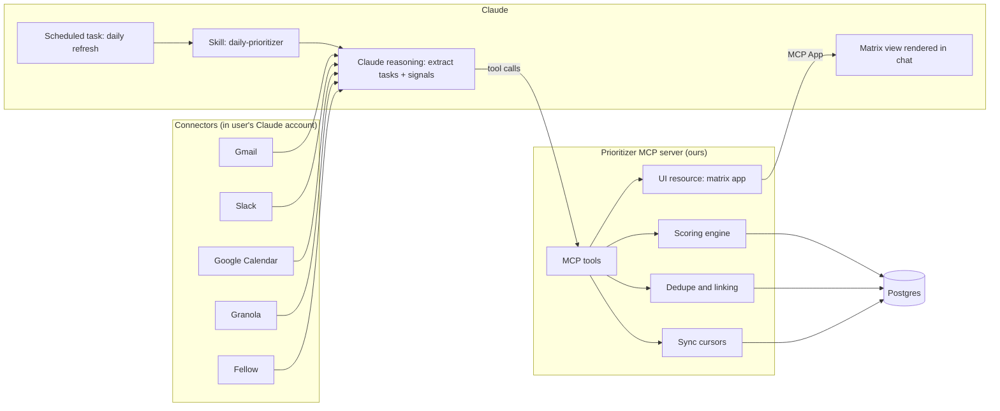
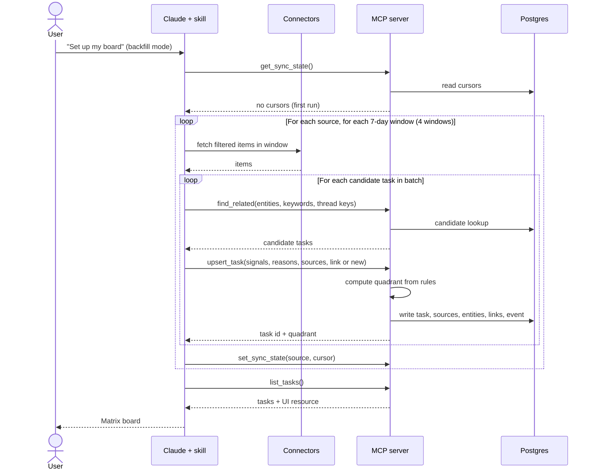
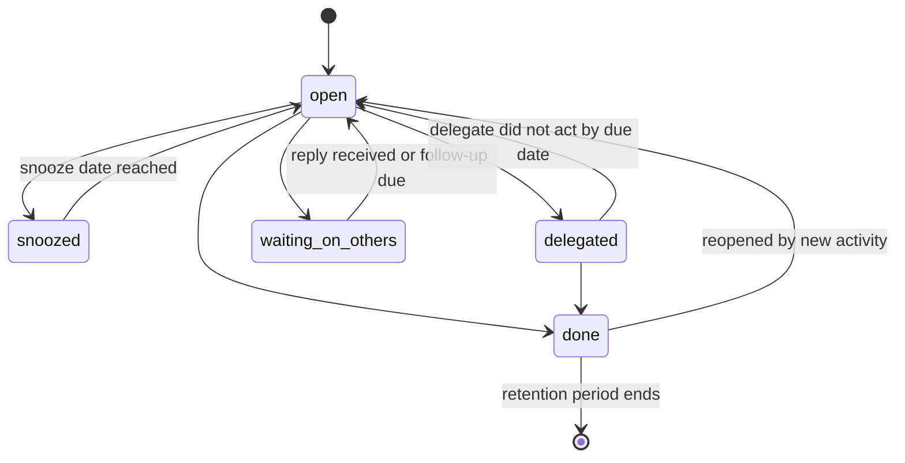
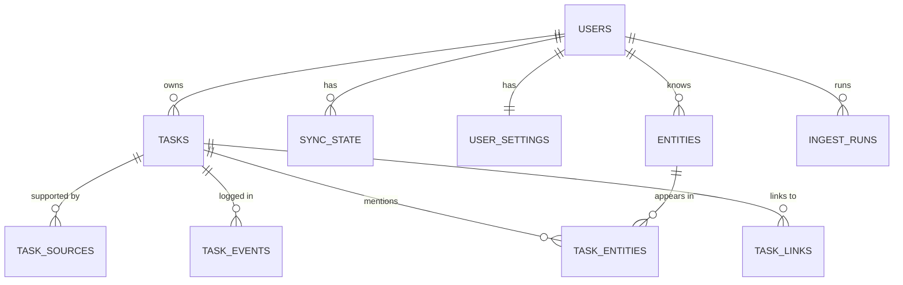

# Operating Partner Prioritization Assistant: Design Document

| Field | Value |
| --- | --- |
| Project | AI daily prioritization assistant for a private equity client |
| Engagement | red6ai (Jeevan Reddy) |
| Author | Nimesh |
| Version | 0.1 (POC design) |
| Date | 18 Oct 2026 |
| POC due | Mon 19 Oct 2026, plugged into Jeevan's own Claude |

---

## Table of contents

1. Problem statement
2. Goals and non-goals
3. Users and use cases
4. Requirements
5. Solution approach and key decisions
6. Architecture
7. Data flows
8. Data model: what we store (and what we don't)
9. Signals and scoring rules
10. Deduplication and linking
11. MCP server tool contract
12. Skill design
13. Per-source ingestion details
14. Context budget and batching
15. Matrix view (UI)
16. Security and privacy
17. Tech stack and deployment
18. POC scope, plan and success criteria
19. Path from POC to production
20. Risks and mitigations
21. Open questions
22. Appendix: example payloads

---

## 1. Problem statement

### 1.1 Client context

- A private equity fund that targets deals between **$5M and $100M**.
- A lean team of **10 to 20 people**: principals, CFO, CTO, COO, and MBA associates who cost around **$300K each**.
- Unlike VCs, the fund takes **majority stakes** and puts operating partners on portfolio company boards. One operating partner typically sits on **5 to 6 boards at once**.
- An operating partner has two workstreams:
  1. **Deal evaluation:** assessing incoming deals.
  2. **Portfolio monitoring:** tracking portfolio company KPIs and unblocking CEOs on hiring, legal and operational needs.
- Scaling by hiring more associates is not viable. The client's priority is **efficiency within the existing team**.

### 1.2 The problem

An operating partner's work arrives through many channels at once: meeting recordings (Fellow, Granola), email, Slack, and the calendar. Commitments, asks and risks are spread across all of them. Today:

- There is no single view of **what needs attention today and why**.
- Deciding what matters means **re-reading threads and transcripts** to rebuild context.
- Asks get lost between meetings, especially across 5 to 6 portfolio companies.
- The same topic shows up in several places (an email, a Slack thread, two calls with the same CEO) and is hard to connect.

### 1.3 What we are building

A **daily prioritization assistant that lives inside Claude**. It reads the partner's recent context, extracts tasks, and sorts them into an **Eisenhower 2x2** (Do, Schedule, Delegate, Defer). Every task carries **full sourcing context**: why it is urgent or important, and links to the source items that support that classification. The partner can then **act on a task from the same chat**, for example drafting a reply or scheduling a follow-up, using Claude's existing app integrations.

---

## 2. Goals and non-goals

### 2.1 Goals (POC)

- G1. Ingest the **last 30 days** of context from the connected tools on first run.
- G2. **Refresh daily**, processing only items that are new since the last run.
- G3. Extract tasks and classify each one into an Eisenhower quadrant, **consistently and explainably**.
- G4. Attach **sources and reasoning** to every task, so the user can act without re-investigating.
- G5. Detect whether a new item is a **net-new task or an update** to an existing one, and **link related threads**.
- G6. Show the matrix **inside Claude** and let the user act on tasks through chat.
- G7. Run in **Jeevan's own Claude account** by Monday, with minimal setup.

### 2.2 Non-goals (POC)

- WhatsApp ingestion (no official connector route).
- Multi-user or team-wide deployment, and per-team delegation workflows.
- Sending any message or creating any event **without explicit user confirmation**.
- Storing raw emails, transcripts or attachments.
- An owned ingestion pipeline with direct vendor APIs (this is the production phase; see section 19).
- Mobile-specific UI work.
- ML-based ranking or learned personalization.

---

## 3. Users and use cases

### 3.1 Users

| User | Role in this project |
| --- | --- |
| Operating partner at the PE fund | Primary end user |
| Jeevan (red6ai) | POC tester using his own data and Claude account |
| Nimesh | Builder and operator of the MCP server |

### 3.2 User stories

- US1. As a partner, when I start my day I see a 2x2 board of tasks so I know what to do first.
- US2. As a partner, I can open any task and see **why** it is in its quadrant and **which emails, threads or meetings** support it.
- US3. As a partner, when a CEO follows up on something we discussed on a call, I see it as an **update to the same task**, not a duplicate.
- US4. As a partner, I can say "draft a reply to this" or "schedule 30 minutes with her this week" and Claude does it, asking me before sending.
- US5. As a partner, I can mark a task done, snooze it, or delegate it to a named teammate.
- US6. As a partner, I can say "refresh my board" at any time to pull in the latest context.
- US7. As a partner, if I disagree with a classification I can correct it, and the reason is recorded.

---

## 4. Requirements

### 4.1 Functional requirements

| ID | Requirement | Priority (POC) |
| --- | --- | --- |
| FR-1 | Initial backfill of the last 30 days from each connected source, processed in batches | Must |
| FR-2 | Daily refresh that processes only items newer than each source's sync cursor | Must |
| FR-3 | Extract candidate tasks (asks, commitments, decisions pending, risks) from each item | Must |
| FR-4 | Produce structured **signals** per task (deadline, waiting on user, requester tier, deal or KPI risk, and so on) | Must |
| FR-5 | Compute the quadrant **deterministically on the server** from the signals | Must |
| FR-6 | Store **source pointers** (type, ID, link, timestamp, short excerpt) for every task | Must |
| FR-7 | Store a human-readable **reason** for urgency and importance on every task | Must |
| FR-8 | Before creating a task, look up related existing tasks; update instead of duplicating when they match | Must |
| FR-9 | Link related tasks (same person, company, deal or thread) | Should |
| FR-10 | Render the matrix inside Claude as an interactive view | Must |
| FR-11 | Let the user change status: open, done, snoozed (with a date), delegated (with an assignee) | Must |
| FR-12 | Let the user override a quadrant, with the override recorded and kept on future refreshes | Should |
| FR-13 | Let the user act on a task via chat (draft reply, schedule follow-up), with confirmation before any send | Must |
| FR-14 | Recompute urgency over time as deadlines approach, without re-ingesting | Must |
| FR-15 | Keep an audit log of every change to a task (who or what changed it, and when) | Should |
| FR-16 | Support a manual "refresh my board" trigger in addition to the scheduled run | Must |

### 4.2 Non-functional requirements

| ID | Requirement |
| --- | --- |
| NFR-1 Privacy | Store pointers and short excerpts only (excerpt capped at 280 characters). No full bodies, transcripts or attachments. |
| NFR-2 Consistency | The same signals must always map to the same quadrant. Scoring rules live in versioned config on the server. |
| NFR-3 Explainability | Every quadrant decision shows its signals, the rule that fired, and its sources. |
| NFR-4 Security | MCP server requires authentication. Data is encrypted in transit and at rest. |
| NFR-5 Context limits | Ingestion runs in bounded batches so no single Claude turn overflows context. |
| NFR-6 Latency | `list_tasks` responds in under 1 second for up to 500 open tasks. |
| NFR-7 Idempotency | Re-running a batch must not create duplicate tasks or duplicate source references. |
| NFR-8 Auditability | All writes are logged in `task_events`. |
| NFR-9 Portability | The server is a standard remote MCP server (Streamable HTTP), so it can later be used from other MCP clients. |
| NFR-10 Retention | Closed tasks are kept for 90 days, then deleted. Full deletion on request. |

---

## 5. Solution approach and key decisions

### 5.1 Approach in one paragraph

Claude is the ingestion and judgment engine. A **skill** tells Claude exactly how to read each connector, what counts as a task, and what signals to produce. Claude then calls a small **MCP server we own**, which holds the task store, applies deterministic scoring rules, handles dedupe and linking, and serves the matrix as an interactive view inside Claude. A **scheduled task** in Claude runs the refresh daily. When the user wants to act, Claude re-fetches the full source through the connector and drafts the action.

### 5.2 Key decisions

| # | Decision | Why | Trade-off |
| --- | --- | --- | --- |
| D1 | **Claude is the pipeline.** Connectors are read by Claude, not by our server. | Connectors are already authorized in the user's Claude account, so there is zero ingestion code to write for the POC. Our server cannot call those connectors anyway. | Refresh only happens when Claude runs (scheduled task or manual trigger). Fixed in production by owned ingestion. |
| D2 | **Store pointers, not content.** | Keeps confidential deal context out of our database; keeps the DB small; the original tools stay the source of truth. | Acting on a task needs a re-fetch through the connector. Acceptable, because that is when full context is needed. |
| D3 | **Claude judges, the server decides.** Claude outputs signals; the server maps signals to a quadrant with fixed rules. | Consistent results across runs, easy tuning when the user disagrees, explainable output, testable logic. | Rules need tuning on real data. Mitigated by config and override logging. |
| D4 | **Dedupe is a two-step handshake.** Server returns candidate matches; Claude decides "update or new". | Server is good at fast lookup; Claude is good at semantic judgment. | One extra tool call per task. Fine at POC volumes. |
| D5 | **UI is an MCP App served by our server.** | Renders an interactive board inside the Claude conversation; data comes live from our DB. | UI must follow MCP Apps constraints (sandboxed iframe). |
| D6 | **Skill encodes the procedure.** | The whole workflow is versioned, portable and reviewable as one file set. | Skill quality matters a lot; needs iteration on real data. |
| D7 | **Postgres** as the store. | Relational data (tasks, sources, entities, links), `pg_trgm` for fuzzy matching, `pgvector` available later. | Slightly more setup than SQLite, but production-ready from day one. |

---

## 6. Architecture

### 6.1 Component overview

| Component | What it is | Responsibility |
| --- | --- | --- |
| Claude (web or desktop) | The user's Claude account | Runs the skill, reads connectors, extracts tasks and signals, calls our tools, renders the UI, drafts actions |
| Connectors | Gmail, Slack, Google Calendar, Granola, Fellow | Read access to the user's sources (and write access for replies and events, with confirmation) |
| Skill: `daily-prioritizer` | SKILL.md plus reference files | The procedure: modes, filters, batching, task definition, signal schema, output rules |
| Scheduled task | Claude scheduled task | Triggers the refresh every weekday morning |
| Prioritizer MCP server | Node.js + TypeScript, MCP SDK, Streamable HTTP | Task store API, scoring, dedupe candidates, linking, sync cursors, audit log, UI resource |
| Postgres | Managed Postgres | Persistent storage |
| Matrix view | MCP App UI resource served by our server | Interactive 2x2 board inside Claude |

### 6.2 Architecture diagram



### 6.3 Responsibility boundary

| Concern | Claude | Our server |
| --- | --- | --- |
| Reading sources | Yes | No |
| Deciding "is this a task?" | Yes | No |
| Producing signals and reasons | Yes | No |
| Deciding the quadrant | No | Yes (rules) |
| Finding possible duplicates | No | Yes (candidates) |
| Deciding "update or new" | Yes | No |
| Storing tasks, sources, links | No | Yes |
| Tracking what has been synced | No | Yes |
| Rendering the board | Host only | Yes (UI resource) |
| Drafting and sending replies | Yes, with user confirmation | No |

---

## 7. Data flows

### 7.1 Initial backfill (first run)



### 7.2 Daily refresh

1. Scheduled task fires (weekdays, early morning IST) or the user says "refresh my board".
2. Claude calls `get_sync_state` and gets the cursor for each source.
3. For each source, Claude fetches only items **after** the cursor, applying the source filters (section 13).
4. For each candidate task: `find_related`, then `upsert_task` as an update or a new task.
5. Claude also checks for **resolution signals** (for example, the user already replied, or the meeting happened) and calls `update_status` where a task is clearly done. These are proposed, not silently closed, unless the evidence is unambiguous (section 12.4).
6. Claude calls `set_sync_state` per source after its batches succeed.
7. Server recomputes urgency for all open tasks (deadlines move closer every day).
8. Claude calls `list_tasks` and shows the board, plus a short summary: new tasks, updated tasks, tasks that moved quadrant.

### 7.3 Acting on a task

1. User clicks a task card or says "draft a reply to the Acme CFO".
2. Claude calls `get_task(id)` to get the sources.
3. Claude re-fetches the **full** source through the connector (email thread, Slack thread, transcript).
4. Claude drafts the reply or the event and **shows it to the user**.
5. Only after explicit confirmation, Claude sends it through the connector.
6. Claude calls `update_status` (for example, to `waiting_on_others` or `done`) and the action is logged.

### 7.4 Status change and override

- Status changes come from the UI or from chat: `update_status(id, status, snooze_until?, delegate_to?)`.
- Quadrant overrides: `override_quadrant(id, quadrant, reason)`. The override is **sticky**: future refreshes update signals and sources, but the displayed quadrant stays as overridden until the user clears it or the task is closed.

### 7.5 State machine for a task



---

## 8. Data model: what we store (and what we don't)

### 8.1 Storage principles

- **Pointers, not content.** We store where a fact lives, not the fact's full text.
- **Short excerpts only**, capped at 280 characters, so the board can explain itself without a re-fetch.
- **Signals and reasons** are stored because they drive scoring and explanations.
- **Everything is attributable**: each change is in `task_events`.

### 8.2 What we store

| Data | Example | Why |
| --- | --- | --- |
| Task title and summary | "Send revised hiring plan to Acme CEO" | Board display |
| Signals | deadline, waiting_on_user, requester tier, risk flags | Scoring |
| Reasons | "CEO asked on Tue; board meeting Thu" | Explainability |
| Quadrant and scores | Q1, urgency 5, importance 6, rule version | Display and audit |
| Status | open, snoozed, delegated, done | Workflow |
| Source pointers | gmail thread ID, link, timestamp, excerpt | Sourcing and re-fetch |
| Entities | People, companies, deals, portfolio companies | Dedupe and linking |
| Task links | related, follows up, duplicate of | Threading |
| Sync cursors | last processed timestamp or ID per source | Incremental refresh |
| Audit events | created, updated, rescored, status changed, overridden | Traceability |
| User settings | timezone, team map for delegation, VIP list | Scoring and delegation |

### 8.3 What we do not store

| Data | Reason |
| --- | --- |
| Full email bodies and Slack messages | Confidential; re-fetchable through connectors |
| Meeting transcripts and recordings | Confidential and large; re-fetchable |
| Attachments | Confidential; out of scope |
| Connector credentials or tokens | Owned by the user's Claude account, never passed to us |
| Calendar event bodies | Only title, time, attendees needed |

### 8.4 Schema (Postgres)

```sql
-- Extensions
CREATE EXTENSION IF NOT EXISTS pg_trgm;
CREATE EXTENSION IF NOT EXISTS pgcrypto;

-- Users (one row in the POC)
CREATE TABLE users (
  id            uuid PRIMARY KEY DEFAULT gen_random_uuid(),
  email         text UNIQUE NOT NULL,
  display_name  text,
  timezone      text NOT NULL DEFAULT 'Asia/Kolkata',
  created_at    timestamptz NOT NULL DEFAULT now()
);

-- User settings: VIPs, team map for delegation, scoring overrides
CREATE TABLE user_settings (
  user_id         uuid PRIMARY KEY REFERENCES users(id) ON DELETE CASCADE,
  vip_entities    jsonb NOT NULL DEFAULT '[]',   -- [{ "type": "person", "name": "...", "tier": "portfolio_ceo" }]
  team_map        jsonb NOT NULL DEFAULT '[]',   -- [{ "name": "...", "handles": ["hiring","legal"] }]
  scoring_config  jsonb,                         -- optional per-user override of default rules
  updated_at      timestamptz NOT NULL DEFAULT now()
);

-- Sync cursors per source
CREATE TABLE sync_state (
  user_id        uuid REFERENCES users(id) ON DELETE CASCADE,
  source         text NOT NULL CHECK (source IN ('gmail','slack','gcal','granola','fellow')),
  cursor_value   text,                 -- ISO timestamp or source-specific ID
  last_run_at    timestamptz,
  last_status    text,                 -- ok | partial | error
  last_error     text,
  items_seen     integer NOT NULL DEFAULT 0,
  PRIMARY KEY (user_id, source)
);

-- Tasks
CREATE TABLE tasks (
  id                   uuid PRIMARY KEY DEFAULT gen_random_uuid(),
  user_id              uuid NOT NULL REFERENCES users(id) ON DELETE CASCADE,
  title                text NOT NULL,                 -- imperative, under 90 chars
  summary              text,                          -- 1 to 3 sentences
  kind                 text NOT NULL CHECK (kind IN ('ask','commitment','decision','risk','follow_up','prep')),
  workstream           text CHECK (workstream IN ('deal','portfolio','fund_ops','other')),

  -- signals (produced by Claude)
  due_at               timestamptz,
  due_confidence       text CHECK (due_confidence IN ('explicit','inferred','none')),
  waiting_on_user      boolean NOT NULL DEFAULT false,
  ask_received_at      timestamptz,
  requester_tier       text CHECK (requester_tier IN ('lp','principal','portfolio_ceo','portfolio_exec','internal_team','external_counterparty','vendor','unknown')),
  risk_flags           text[] NOT NULL DEFAULT '{}', -- deal_risk, kpi_risk, legal, financial, board, people
  urgency_language     boolean NOT NULL DEFAULT false,
  delegable            boolean NOT NULL DEFAULT false,
  suggested_delegate   text,
  claude_importance    smallint CHECK (claude_importance BETWEEN 0 AND 2),

  -- reasons (shown to the user)
  urgency_reason       text,
  importance_reason    text,

  -- computed by server
  urgency_score        smallint,
  importance_score     smallint,
  quadrant             text CHECK (quadrant IN ('do','schedule','delegate','defer')),
  quadrant_override    text CHECK (quadrant_override IN ('do','schedule','delegate','defer')),
  override_reason      text,
  rules_version        text,

  -- workflow
  status               text NOT NULL DEFAULT 'open'
                       CHECK (status IN ('open','snoozed','delegated','waiting_on_others','done')),
  snooze_until         timestamptz,
  delegated_to         text,

  first_seen_at        timestamptz NOT NULL DEFAULT now(),
  last_activity_at     timestamptz NOT NULL DEFAULT now(),
  updated_at           timestamptz NOT NULL DEFAULT now(),
  closed_at            timestamptz
);
CREATE INDEX tasks_user_status_idx ON tasks (user_id, status);
CREATE INDEX tasks_title_trgm_idx ON tasks USING gin (title gin_trgm_ops);

-- Source pointers (many per task)
CREATE TABLE task_sources (
  id              uuid PRIMARY KEY DEFAULT gen_random_uuid(),
  task_id         uuid NOT NULL REFERENCES tasks(id) ON DELETE CASCADE,
  source          text NOT NULL CHECK (source IN ('gmail','slack','gcal','granola','fellow')),
  external_id     text NOT NULL,       -- message ID, Slack ts, event ID, meeting ID
  thread_key      text,                -- Gmail thread ID, Slack channel:thread_ts, meeting series ID
  url             text,                -- deep link to open the original
  occurred_at     timestamptz NOT NULL,
  author          text,
  excerpt         text CHECK (char_length(excerpt) <= 280),
  role            text CHECK (role IN ('origin','update','evidence','resolution')),
  added_at        timestamptz NOT NULL DEFAULT now(),
  UNIQUE (task_id, source, external_id)   -- idempotency
);
CREATE INDEX task_sources_thread_idx ON task_sources (source, thread_key);

-- Entities: people, companies, deals
CREATE TABLE entities (
  id              uuid PRIMARY KEY DEFAULT gen_random_uuid(),
  user_id         uuid NOT NULL REFERENCES users(id) ON DELETE CASCADE,
  type            text NOT NULL CHECK (type IN ('person','company','deal','portfolio_company')),
  canonical_name  text NOT NULL,
  aliases         text[] NOT NULL DEFAULT '{}',
  emails          text[] NOT NULL DEFAULT '{}',
  tier            text,                -- for people: matches requester_tier values
  UNIQUE (user_id, type, canonical_name)
);
CREATE INDEX entities_name_trgm_idx ON entities USING gin (canonical_name gin_trgm_ops);

CREATE TABLE task_entities (
  task_id    uuid REFERENCES tasks(id) ON DELETE CASCADE,
  entity_id  uuid REFERENCES entities(id) ON DELETE CASCADE,
  role       text,                     -- requester, subject, attendee, owner
  PRIMARY KEY (task_id, entity_id)
);

-- Links between tasks
CREATE TABLE task_links (
  from_task_id  uuid REFERENCES tasks(id) ON DELETE CASCADE,
  to_task_id    uuid REFERENCES tasks(id) ON DELETE CASCADE,
  link_type     text NOT NULL CHECK (link_type IN ('related','follows_up','blocks','duplicate_of')),
  created_at    timestamptz NOT NULL DEFAULT now(),
  PRIMARY KEY (from_task_id, to_task_id, link_type)
);

-- Audit log
CREATE TABLE task_events (
  id          bigserial PRIMARY KEY,
  task_id     uuid REFERENCES tasks(id) ON DELETE CASCADE,
  actor       text NOT NULL CHECK (actor IN ('claude_ingest','claude_chat','user_ui','server_rescore')),
  event_type  text NOT NULL,           -- created, updated, rescored, status_changed, overridden, source_added, linked
  before      jsonb,
  after       jsonb,
  created_at  timestamptz NOT NULL DEFAULT now()
);

-- Ingestion run log
CREATE TABLE ingest_runs (
  id            uuid PRIMARY KEY DEFAULT gen_random_uuid(),
  user_id       uuid REFERENCES users(id) ON DELETE CASCADE,
  mode          text CHECK (mode IN ('backfill','refresh','manual')),
  started_at    timestamptz NOT NULL DEFAULT now(),
  finished_at   timestamptz,
  stats         jsonb                  -- { "new": 12, "updated": 5, "moved_quadrant": 3, "per_source": {...} }
);
```

### 8.5 Entity relationships



---

## 9. Signals and scoring rules

### 9.1 Quadrants

| Quadrant | Label | Meaning |
| --- | --- | --- |
| `do` | Urgent and important | Do today |
| `schedule` | Important, not urgent | Put time on the calendar |
| `delegate` | Urgent, not important to the partner personally | Hand to a teammate |
| `defer` | Neither | Drop, batch, or revisit later |

### 9.2 Signals Claude produces for each task

| Signal | Type | Notes |
| --- | --- | --- |
| `due_at` | timestamp or null | Explicit date, or inferred from context (for example "before Thursday's board meeting") |
| `due_confidence` | explicit, inferred, none | Inferred deadlines score lower than explicit ones |
| `waiting_on_user` | boolean | Someone asked the user directly and is waiting |
| `ask_received_at` | timestamp | When the ask arrived |
| `requester_tier` | enum | See schema; VIP list in settings can force a tier |
| `risk_flags` | set | `deal_risk`, `kpi_risk`, `legal`, `financial`, `board`, `people` |
| `urgency_language` | boolean | "ASAP", "today", "blocking", "urgent" |
| `delegable` | boolean | Could a teammate handle this without the partner? |
| `suggested_delegate` | text | From the team map, if one fits |
| `claude_importance` | 0 to 2 | Claude's judgment of strategic weight, bounded so rules stay dominant |
| `urgency_reason`, `importance_reason` | text | One sentence each, shown on the card |

### 9.3 Urgency score (computed on the server, recomputed daily)

| Rule | Points |
| --- | --- |
| Overdue (`due_at` in the past) | +4 |
| Due within 48 hours | +3 |
| Due within 7 days | +2 |
| Inferred deadline (instead of explicit) | points above minus 1 |
| `waiting_on_user` and ask is older than 2 days | +2 |
| `waiting_on_user` and ask is 2 days old or less | +1 |
| `urgency_language` | +1 |
| `prep` task for a meeting in the next 24 hours | +3 |

**Urgent** when urgency score is **3 or more**.

### 9.4 Importance score

| Rule | Points |
| --- | --- |
| Requester tier: `lp` or `principal` | +3 |
| Requester tier: `portfolio_ceo` | +3 |
| Requester tier: `portfolio_exec` or `internal_team` | +2 |
| Requester tier: `external_counterparty` | +1 |
| `deal_risk` or `kpi_risk` | +3 |
| `board` | +2 |
| `legal` or `financial` | +2 |
| `people` (senior hire, exec departure) | +1 |
| `claude_importance` | +0 to +2 |

**Important** when importance score is **4 or more**.

### 9.5 Quadrant mapping

| Urgent | Important | Delegable | Quadrant |
| --- | --- | --- | --- |
| Yes | Yes | any | `do` |
| No | Yes | any | `schedule` |
| Yes | No | any | `delegate` |
| No | No | any | `defer` |

Additional rules:

- If `quadrant_override` is set, it wins.
- A `do` task that is `delegable` with a `suggested_delegate` gets a "could delegate" hint on the card, but stays in `do`.
- All weights and thresholds live in `scoring_config` (default in code, overridable per user) and carry a `rules_version`. Every task stores the version that scored it.

### 9.6 Ordering within a quadrant

1. Overdue first
2. Then by `due_at` ascending
3. Then by importance score descending
4. Then by `last_activity_at` descending

---

## 10. Deduplication and linking

### 10.1 Goal

When new activity arrives, decide whether it is **a new task**, **an update to an existing task**, or **a related but separate task**.

### 10.2 Server side: candidate lookup (`find_related`)

Given entities, keywords and thread keys, the server returns up to 5 open or recently closed tasks, ranked by:

1. **Exact thread match:** same `thread_key` in `task_sources` (strongest signal).
2. **Entity overlap:** shares a person, company, deal or portfolio company.
3. **Title similarity:** `pg_trgm` similarity above 0.35.
4. **Recency:** activity in the last 30 days.

Each candidate comes back with its title, summary, quadrant, status, entities and last 2 sources.

### 10.3 Claude side: the decision

Claude compares the new item with the candidates and chooses one of:

| Decision | Effect |
| --- | --- |
| `update` | Add the new source with role `update` (or `resolution`), refresh signals and reasons, rescore |
| `new_linked` | Create a new task and link it to the candidate as `related` or `follows_up` |
| `new` | Create a new task with no links |

### 10.4 Entity normalization

- People are matched by email first, then by name with aliases.
- Companies and deals are matched by canonical name with `pg_trgm`; Claude may pass aliases ("Acme", "Acme Health", "AH").
- New entities are created on first sight; the user can merge entities later (production).

### 10.5 Thread keys per source

| Source | Thread key |
| --- | --- |
| Gmail | Gmail thread ID |
| Slack | `channel_id:thread_ts` (or `channel_id:ts` for top-level messages) |
| Google Calendar | Recurring event ID, or event ID |
| Granola | Meeting ID; series by attendee set plus title when available |
| Fellow | Meeting ID; series by recurring meeting ID when available |

---

## 11. MCP server tool contract

All tools are scoped to the authenticated user. Inputs and outputs are JSON.

### 11.1 `get_sync_state`

- **Input:** none
- **Output:** `[{ source, cursor_value, last_run_at, last_status }]`

### 11.2 `set_sync_state`

- **Input:** `{ source, cursor_value, status, items_seen, error? }`
- **Output:** `{ ok: true }`

### 11.3 `find_related`

- **Input:**
  ```json
  {
    "entities": [{ "type": "person", "name": "Priya Shah", "email": "priya@acme.com" }],
    "keywords": ["hiring plan", "VP Sales"],
    "thread_keys": [{ "source": "gmail", "thread_key": "18c2f..." }]
  }
  ```
- **Output:** `{ candidates: [{ task_id, title, summary, quadrant, status, entities, recent_sources, match_reasons }] }`

### 11.4 `upsert_task`

- **Input:**
  ```json
  {
    "decision": "new | update | new_linked",
    "task_id": "required when decision is update",
    "link_to": [{ "task_id": "...", "link_type": "related | follows_up | blocks" }],
    "task": {
      "title": "...",
      "summary": "...",
      "kind": "ask | commitment | decision | risk | follow_up | prep",
      "workstream": "deal | portfolio | fund_ops | other",
      "signals": { "...": "see section 9.2" },
      "urgency_reason": "...",
      "importance_reason": "..."
    },
    "sources": [{ "source": "gmail", "external_id": "...", "thread_key": "...", "url": "...", "occurred_at": "...", "author": "...", "excerpt": "...", "role": "origin" }],
    "entities": [{ "type": "...", "name": "...", "email": "...", "role": "requester" }],
    "run_id": "..."
  }
  ```
- **Output:** `{ task_id, quadrant, urgency_score, importance_score, rules_fired: [...], moved_from?: "schedule" }`
- **Behavior:** idempotent on `(task_id, source, external_id)`; writes a `task_events` row.

### 11.5 `list_tasks`

- **Input:** `{ quadrant?, status? (default open), workstream?, entity?, limit? }`
- **Output:** tasks grouped by quadrant, each with title, reasons, scores, top 3 sources, status
- **UI:** declares the matrix UI resource, so Claude renders the interactive board

### 11.6 `get_task`

- **Input:** `{ task_id }`
- **Output:** full task with all sources, entities, links and the last 10 events

### 11.7 `update_status`

- **Input:** `{ task_id, status, snooze_until?, delegated_to?, note? }`
- **Output:** `{ ok: true, task }`

### 11.8 `override_quadrant`

- **Input:** `{ task_id, quadrant | null, reason }` (null clears the override)
- **Output:** `{ ok: true, task }`

### 11.9 `start_run` and `finish_run`

- **Input:** `start_run({ mode })` returns `{ run_id }`; `finish_run({ run_id, stats })`
- **Purpose:** groups a refresh for the summary and for debugging

### 11.10 `get_settings` and `update_settings`

- **Purpose:** VIP list, team map for delegation, timezone, scoring overrides

---

## 12. Skill design

### 12.1 Files

```
daily-prioritizer/
  SKILL.md                 # modes, procedure, rules
  reference/
    task-definition.md     # what counts as a task, with examples and non-examples
    signals.md             # signal schema with examples per tier and flag
    source-filters.md      # per-source fetch filters and batch sizes
    pe-context.md          # PE operating partner context: deal vs portfolio work, board cadence
```

### 12.2 Modes

| Mode | Trigger | What it does |
| --- | --- | --- |
| `setup` | "Set up my board" | Collect VIPs and team map, then run `backfill` |
| `backfill` | First run | 30 days, in 4 weekly windows per source |
| `refresh` | Scheduled task or "refresh my board" | Items after each cursor only |
| `act` | "Draft a reply", "schedule this", card click | Re-fetch full source, draft, confirm, execute, update status |
| `review` | "Why is this in Do?" | Explain signals, rules fired and sources |

### 12.3 What counts as a task

Include:

- A direct ask to the user ("Can you send...", "Need your sign-off on...")
- A commitment the user made ("I'll get back to you by Friday")
- A pending decision the user owns
- A risk the user should act on (KPI miss, key hire leaving, legal issue)
- Prep needed for an upcoming meeting
- A follow-up the user is owed and should chase

Exclude:

- FYI messages with no action
- Newsletters, notifications, automated mail
- Asks directed at someone else (unless the user is the escalation point)
- Items already resolved within the same thread

### 12.4 Procedure rules

1. Always call `get_sync_state` first; never fetch before the cursor in `refresh` mode.
2. Process one source and one window at a time; never more than the batch limit (section 14).
3. For every candidate task, call `find_related` before `upsert_task`.
4. Prefer `update` when a thread key matches.
5. Write reasons as one plain sentence each, naming the person and the date.
6. Excerpts are at most 280 characters and contain the sentence that proves the ask.
7. Close a task automatically only when the user's own reply or action clearly resolves it; otherwise list it as "possibly resolved" in the summary.
8. Never send a message or create an event without showing the draft and getting a yes.
9. Call `set_sync_state` only after the source's batches succeed.
10. End every refresh with `list_tasks` and a summary of new, updated and moved tasks.

---

## 13. Per-source ingestion details

| Source | What to fetch | Filter | Cursor | Excerpt from |
| --- | --- | --- | --- | --- |
| Gmail | Threads with activity after the cursor | User in To or Cc; exclude promotions, notifications, newsletters; prioritize threads where the last message is not from the user | Timestamp of the latest processed message | The sentence with the ask or commitment |
| Slack | DMs, group DMs, mentions, threads the user participates in | Exclude bot messages and channels marked as noise in settings | Latest processed `ts` | The message with the ask |
| Google Calendar | Events in the next 7 days, plus events ended since the cursor | Events with external attendees or VIPs; skip declined and all-day personal events | Timestamp | Event title and attendees (no body) |
| Granola | Meetings since the cursor | All meetings the user attended | Meeting end time | The action item or decision line from the notes |
| Fellow | Meetings and action items since the cursor | Action items assigned to the user, plus decisions in meetings with VIPs | Meeting end time | The action item text |

Calendar has a special role: it creates `prep` tasks for important upcoming meetings, and it provides "meeting happened" evidence that can move tasks from `waiting_on_others` back to `open`.

---

## 14. Context budget and batching

The main technical risk in the POC is **context overflow** when reading 30 days of data in one go.

| Parameter | POC value |
| --- | --- |
| Backfill windows | 4 windows of 7 days, oldest first |
| Gmail batch | 20 threads per batch, latest 3 messages per thread |
| Slack batch | 50 messages per batch |
| Meetings batch | 5 meetings per batch (notes and action items, not full transcripts) |
| Calendar batch | All events in window (small) |
| Per-item handling | Extract tasks and signals, write them, then drop the raw content from working memory |

Rules:

- Use summaries and action items from Granola and Fellow during ingestion; read full transcripts only in `act` mode.
- If a batch fails, the cursor is not advanced, so the next run retries it (writes are idempotent).
- Backfill can run across more than one conversation if needed; cursors make it resumable.

---

## 15. Matrix view (UI)

### 15.1 Layout

- A 2x2 grid: **Do** (top left), **Schedule** (top right), **Delegate** (bottom left), **Defer** (bottom right).
- A header with the last refresh time, counts per quadrant, and a "Refresh" button.
- Filters: workstream (deal, portfolio, fund ops), portfolio company, person.

### 15.2 Task card

- Title
- Due date chip (red when overdue)
- Requester and portfolio company
- One-line urgency reason and importance reason
- Source icons (Gmail, Slack, Calendar, Granola, Fellow), each linking to the original
- "Could delegate to X" hint where it applies
- Override marker when the quadrant was set by the user

### 15.3 Interactions

| Interaction | Effect |
| --- | --- |
| Click card | Expands sources and full reasoning (from `get_task`) |
| "Act" button | Sends a message into the chat, for example "Draft a reply for task 123" |
| Done, snooze, delegate buttons | Call `update_status` |
| Move to another quadrant | Calls `override_quadrant`, asks for a reason |
| Refresh | Sends "refresh my board" into the chat |

---

## 16. Security and privacy

| Area | POC approach | Production approach |
| --- | --- | --- |
| Authentication to MCP server | OAuth with a single allowed account (Jeevan) | OAuth per user, org-level access control |
| Transport | HTTPS only | HTTPS only |
| Data at rest | Managed Postgres with encryption at rest | Same, plus field-level encryption for excerpts |
| Data minimization | Pointers and 280-character excerpts only | Same |
| Connector tokens | Never handled by our server | Production owned ingestion stores tokens in a secrets manager |
| Logging | No excerpts or reasons in application logs | Same, plus structured audit export |
| Retention | Closed tasks deleted after 90 days | Configurable per client |
| Deletion | Full wipe on request (single SQL routine) | Self-serve deletion |
| Actions | Every send or event creation needs user confirmation | Same |
| Hosting region | Nearest region to the client available on the host | Client's chosen region |

---

## 17. Tech stack and deployment

| Layer | Choice |
| --- | --- |
| Language | TypeScript on Node.js 20+ |
| MCP | Official MCP TypeScript SDK, Streamable HTTP transport |
| HTTP framework | Express or Hono |
| Validation | Zod schemas for every tool input and output |
| Database | Postgres (Neon or Supabase), with `pg_trgm` |
| Migrations | Plain SQL migrations (or Drizzle) |
| UI | Single HTML bundle served as the MCP App resource |
| Hosting | Railway, Fly.io or Render |
| Secrets | Host's environment variables |
| Tests | Vitest for scoring rules and dedupe ranking |

### 17.1 Environment variables

| Variable | Purpose |
| --- | --- |
| `DATABASE_URL` | Postgres connection string |
| `OAUTH_ISSUER`, `OAUTH_CLIENT_ID`, `OAUTH_CLIENT_SECRET` | Auth for the MCP server |
| `ALLOWED_USER_EMAILS` | Allowlist for the POC |
| `SCORING_RULES_VERSION` | Active default rules version |
| `PUBLIC_BASE_URL` | Server URL used in links and the UI resource |

### 17.2 Setup in Jeevan's Claude

1. Confirm Gmail, Slack, Google Calendar, Granola and Fellow connectors are connected.
2. Add the Prioritizer MCP server as a custom connector and complete sign-in.
3. Add the `daily-prioritizer` skill.
4. Say "Set up my board" to run setup and backfill.
5. Create the daily scheduled task ("Refresh my board" at a fixed morning time).

---

## 18. POC scope, plan and success criteria

### 18.1 In scope for Monday

- MCP server with: `get_sync_state`, `set_sync_state`, `find_related`, `upsert_task`, `list_tasks`, `get_task`, `update_status`, `override_quadrant`, `start_run`, `finish_run`
- Postgres schema from section 8.4
- Scoring rules from section 9, with unit tests
- Skill with `setup`, `backfill`, `refresh`, `act` modes
- Matrix UI with cards, sources and status buttons
- Deployed server reachable from Jeevan's Claude

### 18.2 Deferred

- `get_settings` and `update_settings` UI (settings can be seeded directly for the POC)
- Entity merge, filters in the UI, ingest run analytics
- Evaluation set and accuracy measurement

### 18.3 Build order

| Step | Work | Estimate |
| --- | --- | --- |
| 1 | Schema, migrations, DB connection | 1 h |
| 2 | Scoring engine and unit tests | 1.5 h |
| 3 | MCP tools (CRUD, sync, dedupe lookup) | 3 h |
| 4 | Auth and deployment | 1.5 h |
| 5 | Skill and reference files | 2 h |
| 6 | Matrix UI resource | 2.5 h |
| 7 | End-to-end run on test data, then tune | 2 h |
| 8 | Setup guide for Jeevan | 0.5 h |
| | **Total** | **About 14 h** |

### 18.4 Demo success criteria

- Backfill on Jeevan's data finishes without context errors.
- At least 80% of the tasks on the board are ones Jeevan agrees are real tasks.
- Every task shows at least one source he recognizes, with a working link.
- No obvious duplicates for the same thread.
- He can act on one task end to end (draft, confirm, send) from the board.

---

## 19. Path from POC to production

| Area | POC | Production |
| --- | --- | --- |
| Ingestion | Claude reads connectors on schedule or demand | Owned pipeline: direct Gmail, Slack, Calendar, Granola and Fellow APIs, webhooks where available, a job queue |
| Reasoning | Claude in the user's account | Claude API calls from our backend for extraction; Claude in chat for acting |
| Freshness | Daily, or on demand | Near real time via webhooks |
| Matching | Thread keys, entities, trigram similarity | Add embeddings (`pgvector`) for semantic matching |
| Users | One | The whole fund, with roles and shared delegation |
| Delegation | Hint only | Assign to teammates, track their status |
| Quality | Manual review | Labeled eval set, accuracy tracking, learning from overrides |
| Extra sources | None | WhatsApp (via an approved business route if possible), CRM, portfolio KPI dashboards |
| Ops | Single deployment | Monitoring, alerting, backups, per-client isolation |

---

## 20. Risks and mitigations

| Risk | Impact | Mitigation |
| --- | --- | --- |
| Context overflow during backfill | Run fails or misses items | Windowed batches, summaries instead of transcripts, resumable cursors |
| Noisy task extraction | Board loses trust | Strict task definition, exclusion list, VIP-weighted importance, user overrides |
| Duplicates across sources | Cluttered board | Thread keys first, entity overlap, Claude decides with candidates |
| Wrong quadrant | Misplaced priorities | Transparent rules, reasons on every card, sticky overrides, tunable config |
| Refresh depends on Claude running | Board goes stale | Scheduled task plus manual refresh; owned ingestion in production |
| Connector differences between accounts | Setup breaks on demo day | Verify each connector in Jeevan's account before the demo |
| Confidential data exposure | Client trust and legal risk | Pointers only, short excerpts, auth, encryption, retention policy |
| MCP App rendering issues on some clients | Board not visible | Text fallback in `list_tasks` output |

---

## 21. Open questions

1. Which tools does the PE operating partner actually use daily (confirm Fellow vs Granola, Gmail vs Outlook, Slack vs Teams)?
2. Will the POC run on Jeevan's own data, or on sample data from the client?
3. Does Jeevan's Claude plan support custom connectors and scheduled tasks?
4. Is there a team map we can use for the Delegate quadrant (who handles hiring, legal, finance)?
5. Who are the VIPs (LPs, principals, portfolio CEOs) that should raise importance?
6. What time should the daily refresh run, and in which timezone (client is likely outside India)?
7. What data residency or compliance requirements does the client have?
8. When is the client demo, and who will attend?

---

## 22. Appendix: example payloads

### 22.1 `upsert_task` input (new task from an email)

```json
{
  "decision": "new",
  "task": {
    "title": "Send revised VP Sales hiring plan to Acme CEO",
    "summary": "Priya asked for the revised hiring plan and comp bands before Thursday's board meeting.",
    "kind": "ask",
    "workstream": "portfolio",
    "signals": {
      "due_at": "2026-10-22T09:00:00Z",
      "due_confidence": "inferred",
      "waiting_on_user": true,
      "ask_received_at": "2026-10-16T14:12:00Z",
      "requester_tier": "portfolio_ceo",
      "risk_flags": ["board", "people"],
      "urgency_language": false,
      "delegable": false,
      "claude_importance": 2
    },
    "urgency_reason": "Priya asked on Fri 16 Oct and needs it before Thursday's board meeting.",
    "importance_reason": "Portfolio CEO request tied to a board agenda item on a senior hire."
  },
  "sources": [
    {
      "source": "gmail",
      "external_id": "msg_18c2f9a",
      "thread_key": "thr_18c2f00",
      "url": "https://mail.google.com/mail/u/0/#all/thr_18c2f00",
      "occurred_at": "2026-10-16T14:12:00Z",
      "author": "Priya Shah",
      "excerpt": "Could you send the revised VP Sales plan with comp bands before Thursday's board?",
      "role": "origin"
    }
  ],
  "entities": [
    { "type": "person", "name": "Priya Shah", "email": "priya@acme.example", "role": "requester" },
    { "type": "portfolio_company", "name": "Acme Health", "role": "subject" }
  ],
  "run_id": "run_7f1"
}
```

### 22.2 Scoring for that task

| Rule | Points |
| --- | --- |
| Due within 7 days (inferred, so minus 1) | +1 |
| Waiting on user, ask 2 days old or less | +1 |
| **Urgency** | **2 (not urgent yet)** |
| Requester tier `portfolio_ceo` | +3 |
| `board` | +2 |
| `people` | +1 |
| `claude_importance` | +2 |
| **Importance** | **8 (important)** |
| **Quadrant** | **`schedule`** |

On Tuesday 20 Oct the deadline is within 48 hours, so the daily rescore lifts urgency to 3 (48 hours = +3, minus 1 for inferred, plus 1 for waiting) and the task moves to **`do`**. The refresh summary reports the move.

### 22.3 `upsert_task` input (update from a later Slack message)

```json
{
  "decision": "update",
  "task_id": "b2a1...",
  "task": {
    "signals": { "urgency_language": true },
    "urgency_reason": "Priya followed up on Slack on Mon 19 Oct asking for it today."
  },
  "sources": [
    {
      "source": "slack",
      "external_id": "C04ACME:1760860000.0021",
      "thread_key": "C04ACME:1760860000.0021",
      "occurred_at": "2026-10-19T08:40:00Z",
      "author": "Priya Shah",
      "excerpt": "Any chance I can get the hiring plan today? Want to pre-read before Thu.",
      "role": "update"
    }
  ]
}
```
